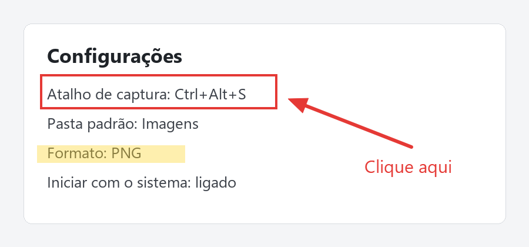
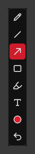
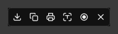
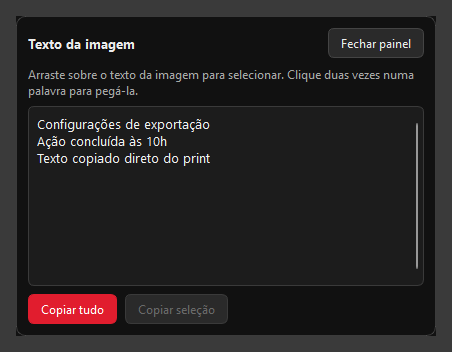
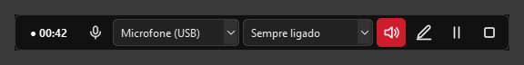

<p align="center">
  
</p>

<h1 align="center">Parzprint</h1>

<p align="center">
  <picture>
    <source media="(prefers-color-scheme: dark)" srcset="docs/img/parzbyte-logo-negativo.svg">
    
  </picture>
</p>

<p align="center">
  <a href="https://github.com/parzbyte/Parzprint/releases/latest"><b>Baixar para Windows ou Linux</b></a>
</p>

Parzprint é uma ferramenta de captura de tela para Windows, no estilo do Lightshot. Com um
atalho você escolhe uma área da tela e, a partir dela, pode:

- anotar a imagem com setas, linhas, retângulos, marca-texto e texto, e depois salvar,
  copiar ou imprimir;
- copiar o texto que aparece na imagem, lido no próprio computador pelo
  [Indra OCR](https://github.com/datalab-to/indra), sem conta, sem internet e sem API;
- gravar a área (ou a tela inteira) em vídeo, com o som do microfone e o som do computador,
  desenhando por cima enquanto grava;
- traduzir o texto selecionado em qualquer programa, ou o texto da imagem, pelo Google
  Tradutor.

O app fica na bandeja do sistema e abre junto com o Windows.



## Como usar

### Print e anotações

Aperte o atalho de captura (o padrão é `Ctrl+Shift+S`, e dá para trocar em Configurações).
A tela escurece; arraste para escolher a área, ou clique sem arrastar para pegar o monitor
inteiro. Aparecem duas barras coladas na seleção, como no Lightshot.

| Ferramentas | Ações |
|---|---|
|  |  |

A barra lateral tem lápis, linha, seta, retângulo, marca-texto, texto, cor e desfazer. A roda
do mouse muda o tamanho da ferramenta escolhida, e o botão de cor abre a janela Cor do
próprio Windows. A barra de baixo salva, copia, imprime, lê o texto, grava e fecha.

No editor, `Ctrl+Z` desfaz, `Ctrl+C` ou `Enter` copia a imagem, `Ctrl+S` salva e `Esc` fecha.

### Copiar o texto da imagem

O botão de texto lê a área selecionada e abre um painel ao lado. A seleção funciona como no
Google Lens: você arrasta sobre o texto da própria imagem, de qualquer letra até qualquer
outra, e o trecho fica marcado. Um clique duplo pega uma palavra e `Ctrl+A` pega tudo. Ao
copiar, a captura fecha sozinha, porque o trabalho já terminou.



O modelo do Indra (cerca de 73 MB) vai dentro do executável, então isso funciona offline
desde o primeiro uso.

### Traduzir

Selecione um texto em qualquer programa e aperte `Ctrl+Alt+T` (no Linux o padrão é
`Ctrl+Alt+Y`; troque em Configurações). Uma janela abre junto do ponteiro do mouse com o
texto e a tradução lado a lado, como no Google Tradutor. O idioma de origem é detectado e o
de destino começa em português. Os dois podem ser trocados nas listas, e o botão ⇄ inverte os
idiomas. Os últimos que você usou ficam no topo das listas.

Se não houver nada selecionado, a janela mostra o que estava copiado e espera você apertar
Enter. Nesse caso nada é enviado antes disso. Alguns editores, como o VS Code e o Excel,
copiam a linha inteira quando nada está selecionado, e aí essa linha é traduzida direto.
Para pegar o texto selecionado, o app aperta `Ctrl+C` por você; se não quiser isso, desmarque
"Pegar o texto selecionado" em Configurações e a janela passa a usar só o que você copiou.
Num terminal o app nunca aperta `Ctrl+C`, porque lá ele interromperia o programa em execução.
Para digitar ou colar um texto, abra a janela
pelo item "Traduzir" da bandeja. Na captura, o botão "Traduzir a imagem" lê o texto da área
com o Indra e abre a tradução embaixo dela.

Na janela, `Enter` traduz, `Shift+Enter` quebra a linha, `Ctrl+Enter` copia a tradução e
fecha, e `Esc` fecha. A janela também fecha sozinha quando você clica fora dela, a menos que
o alfinete esteja marcado. Ela não aparece nas gravações de tela. O limite é de 5.000
caracteres por vez. Sem atalho global (Wayland), ligue o comando `parzprint --translate` a um
atalho do sistema.

### Gravar a tela

Depois de escolher a área, clique em Gravar. Uma contagem de 3 segundos aparece e a gravação
começa. Uma barrinha fica colada embaixo da área:



Nela você vê o tempo, troca o microfone, escolhe o modo dele (desligado, sempre ligado ou
apertar para falar com `Ctrl+Alt+Espaço`), liga o som do computador, desenha, pausa e para.
A barrinha e a borda vermelha em volta da área não aparecem no vídeo. Os desenhos e o
ponteiro do mouse aparecem.

Para parar, use o botão da barrinha, o mesmo atalho de captura ou o item "Parar gravação"
da bandeja. O vídeo vai para `Vídeos\Parzprint` em MP4 e é recomprimido em segundo plano
com x264, do mesmo jeito que o HandBrake faz. Resolução (original, 1080p, 720p ou 480p),
quadros por segundo e qualidade ficam em Configurações.

## Instalar

### Windows

Baixe o `Parzprint-windows.zip` em [Releases](https://github.com/parzbyte/Parzprint/releases/latest),
extraia a pasta onde quiser e abra o `Parzprint.exe`. Não precisa instalar nada: o pacote já
traz o Python, o Qt, o modelo do Indra e o FFmpeg. Mantenha a pasta inteira junta, porque o
executável depende da pasta `_internal` que fica ao lado dele.

Na primeira vez o Windows pode mostrar "O Windows protegeu o computador", porque o
executável ainda não tem o certificado de assinatura da Microsoft. Clique em "Mais
informações" e em "Executar assim mesmo". Para ter certeza de que o arquivo é o original,
confira a assinatura de origem (abaixo).

### Linux

Baixe o `Parzprint-linux.tar.gz`, extraia e rode `./Parzprint/Parzprint`. No Linux o print, as
anotações e o texto da imagem estão disponíveis; a gravação de tela ainda é só do Windows.
A versão do Linux é gerada e testada automaticamente, mas ainda não foi usada por uma pessoa num
Linux de verdade. O atalho global precisa de uma sessão X11; no Wayland, cadastre o comando
`parzprint --capture` no atalho de teclado do sistema.

### Conferir se o arquivo é o original

Cada versão é gerada pelo próprio GitHub a partir deste repositório, e o GitHub assina de onde
o arquivo veio. Com o [GitHub CLI](https://cli.github.com/) instalado:

```bash
gh attestation verify Parzprint-windows.zip --repo parzbyte/Parzprint
```

A resposta tem que dizer que a verificação passou. Também dá para comparar o SHA-256 do
arquivo com o que está no `SHA256SUMS.txt` da mesma versão:

```bash
sha256sum Parzprint-linux.tar.gz
```

No Windows, o equivalente é `certutil -hashfile Parzprint-windows.zip SHA256`.

### Pelo código

Precisa do Python 3.11 ou mais novo.

```bash
python -m venv .venv
.venv/Scripts/pip install -e .[dev]
python -m parzprint
```

Para gerar o executável (feche o Parzprint antes, porque com ele aberto o Windows trava os
arquivos de `dist/`):

```bash
python build.py
```

Para rodar os testes:

```bash
pytest
```

## Como foi feito

O Parzprint é escrito em Python com PySide6 (Qt 6). A interface inteira é desenhada pelo
próprio app: os ícones são SVG feitos para ele, e as anotações são desenhadas com o
`QPainter` do Qt, com suavização, o mesmo código na tela e na imagem salva.

### Captura e editor

Ao apertar o atalho, o app fotografa cada monitor com `QScreen.grabWindow` e abre por cima
de cada um uma janela sem borda com essa foto escurecida. Cada monitor guarda a própria
geometria em pixels lógicos e a foto em pixels físicos. É isso que mantém o recorte certo
quando os monitores têm escalas diferentes. As anotações ficam numa lista de objetos (seta,
linha, retângulo...) e desfazer é tirar o último da lista.

### Atalho global

No Windows o atalho é registrado com `RegisterHotKey`, como o Lightshot faz. Assim a
combinação vai só para o Parzprint e não chega ao programa em foco. Isso resolveu um
conflito real com o WhatsApp Web, que também usa `Ctrl+Alt+S`. Uma segunda execução do
programa não abre outra cópia: ela avisa a que já está aberta por um `QLocalServer`.

### Texto da imagem

O Indra devolve a caixa de cada linha de texto. Como a seleção precisa ir de uma letra até
outra, o Parzprint estima onde cada letra fica dentro da linha pela largura relativa das
letras na fonte da tela. O OCR roda numa thread separada para a tela não travar, e sem o
modelo de orientação do Indra, porque um print de tela está sempre de pé.

### Tradutor

O texto selecionado vem de um `Ctrl+C` que o próprio app manda para o programa em foco, e só
vale se a área de transferência mudou. Como o atalho engole a letra, o programa só enxerga
`Ctrl` e `Alt`, e soltar o `Alt` sozinho abre o menu do Bloco de Notas. Por isso o app solta
o `Ctrl` e aperta uma tecla sem função antes do `Ctrl+C`. O pedido vai ao endereço que o
Google usa nas próprias páginas (`translate.googleapis.com`), pela rede do Qt, sem travar a
janela. O texto copiado fica na área de transferência, porque restaurar o conteúdo anterior
(imagem, arquivos) é frágil.

### Gravação

A gravação junta três fontes num único relógio:

1. **Vídeo.** O `QScreenCapture` do Qt entrega os quadros do monitor. Cada quadro é recortado
   para a área, recebe o ponteiro do mouse desenhado por cima (o Qt não traz o ponteiro) e
   segue para um `QVideoFrameInput`, no máximo 30 quadros por segundo.
2. **Microfone.** Vem de um `QAudioSource` do Qt.
3. **Som do computador.** O Qt não grava a saída de som, então ela vem por loopback WASAPI
   com a biblioteca PyAudioWPatch.

Os dois áudios são convertidos para 48 kHz estéreo, misturados em blocos de 20 ms com um
limitador simples e entregues a um `QAudioBufferInput`. Um `QMediaRecorder` grava o MP4 em
H.264 e AAC, usando o codificador do próprio Windows, que funciona com ou sem placa de vídeo.

Para a barrinha e a borda ficarem fora do vídeo, essas janelas usam
`SetWindowDisplayAffinity` com `WDA_EXCLUDEFROMCAPTURE`. A camada de desenho é o contrário:
uma janela transparente por cima da área que o Windows grava junto com a tela. Fora do modo
de desenho ela deixa os cliques passarem para os programas de baixo.

Ao parar, o FFmpeg embutido recomprime o vídeo com x264 em qualidade constante (CRF 20, 23
ou 27, conforme a qualidade escolhida). O arquivo original só é trocado se a compressão der
certo e ficar menor.

### O que foi medido

| Medição | Resultado |
|---|---|
| Processador gravando uma área 800×600 a 30 quadros por segundo | 44% de um núcleo |
| Sincronia entre áudio e vídeo | áudio de 43 a 86 ms depois da imagem |
| Recompressão x264 de 5 segundos | de 758 KB para 136 KB em 0,4 s |
| Leitura do Indra numa imagem pequena | 0,06 s depois de carregar o modelo |

A sincronia anda em passos de 43 ms porque esse é o tamanho de um bloco de áudio AAC.

### Testes

São 335 testes automáticos com pytest. A lógica sem tela (geometria, mistura de áudio,
relógio com pausa, compressão, configurações) é testada direto, e a interface é testada numa
janela do Qt sem tela. Os comportamentos que dependem do Windows de verdade (captura,
exclusão da captura, atalho global, som do computador) foram conferidos com gravações reais
e medidos com o FFmpeg.

Os documentos de design e os planos de implementação de cada etapa estão em
[`docs/superpowers`](docs/superpowers).

## Estrutura

```
parzprint/
  app.py               liga bandeja, atalhos, captura, editor, gravação e tradutor
  overlay.py           janela de seleção de área, uma por monitor
  editor.py            anotações, ações e modo de texto
  annotations.py       modelo das anotações e desenho
  textpanel.py         painel de texto e seleção contínua
  ocr/                 adaptador do Indra
  hotkey.py            atalho global (RegisterHotKey no Windows)
  recording/
    session.py         sessão de gravação e gravador MP4
    audio.py           microfone, som do computador e mistura
    video.py           recorte dos quadros e ponteiro do mouse
    drawlayer.py       camada de desenho durante a gravação
    recordbar.py       barrinha de gravação
    compress.py        recompressão com x264
  translate/
    google.py          pedido e resposta do Google Tradutor
    grab.py            pega o texto selecionado ou o copiado
    languages.py       lista de idiomas
    style.py           folha de estilo da janela
    window.py          janela do tradutor
tests/                 testes automáticos
build.py               gera o executável com PyInstaller
```

## Limitações conhecidas

- O app foi feito pensando também no Linux, mas só foi testado no Windows. No Linux o botão
  Gravar não aparece.
- Em Windows 10 de antes da versão 2004, o Windows não consegue esconder a barrinha do vídeo.
- O ponteiro de texto (a barrinha "I") sai branco no vídeo e some sobre fundo branco.
- O tradutor usa um endereço gratuito do Google que não é oficial. Ele pode limitar os pedidos ou
  mudar sem aviso; quando falha, a janela avisa e oferece abrir o texto no Google Tradutor. O
  texto só vai ao Google quando você pede a tradução, e sem internet o tradutor não funciona.
- O Indra lê "Última" como "Ultima" em letras maiúsculas acentuadas, um limite do modelo.

## O que mudou

O que mudou em cada versão está no [CHANGELOG.md](CHANGELOG.md).

## Licença e marca

O código é livre, sob a [licença MIT](LICENSE): pode usar, modificar e distribuir. A marca
fica de fora: os nomes Parzbyte e Parzprint, a logo, o símbolo e o ícone são da Parzbyte. Uma
versão modificada precisa de outro nome e outro ícone. Os detalhes estão em [MARCA.md](MARCA.md).

## Licenças de terceiros

O executável inclui software de terceiros com licenças próprias:

- [Indra OCR](https://github.com/datalab-to/indra): código Apache 2.0. Os pesos do modelo
  usam uma licença OpenRAIL-M modificada, livre para pesquisa, uso pessoal e empresas com
  menos de US$ 20 milhões de faturamento ou investimento, e que não permite concorrer com a
  API da Datalab.
- [Qt / PySide6](https://www.qt.io/): LGPL v3.
- [FFmpeg](https://ffmpeg.org/) com x264, vindo do pacote `imageio-ffmpeg`: GPL.
- [PyAudioWPatch](https://github.com/s0d3s/PyAudioWPatch): MIT.
